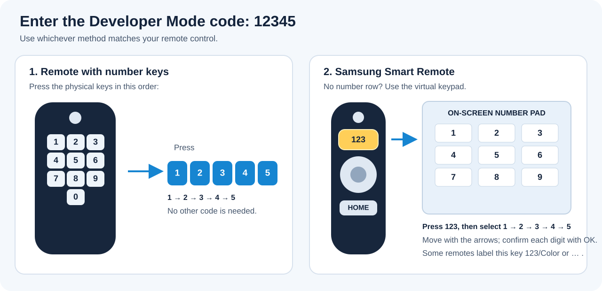

# Installation Guide

The simplest and most recommended option is to use the desktop installer to transfer Moonlight to your TV. You can also use the Apps2Samsung app or, for more advanced users, the Tizen Studio development platform. The app is also distributed as unsigned WGT packages, but it cannot be installed directly on the TV in this format.

## Method A: Use the Moonlight desktop installer

The recommended option is the **Moonlight Tizen Installer**. Run it on a Windows, Linux or macOS computer connected to the same local network as the TV. It discovers compatible Samsung TVs, guides you through installation and prepares the package automatically.

### 1. Download the correct installer

Open the [latest stable release](https://github.com/fidoboy/moonlight-tizen-ac3/releases/latest) and download the matching file from **Assets**:

- **Windows 64-bit:** `MoonlightTizenInstaller.exe`
- **Linux 64-bit:** `MoonlightTizenInstaller.AppImage`
- **macOS Intel:** `MoonlightTizenInstaller-osx-x64.dmg`
- **macOS Apple Silicon:** `MoonlightTizenInstaller-osx-arm64.dmg`

The Windows and Linux downloads are standalone executables. Each macOS DMG contains the app bundle; open the disk image and copy the app to Applications.

### 2. Run the installer

- **Windows:** double-click the downloaded `.exe`. If Microsoft Defender SmartScreen displays a warning, verify that the file came from this project's official release before choosing to run it.
- **macOS:** Open the downloaded `.dmg` from **Downloads**. In the window that opens, drag **Moonlight Tizen Installer** to **Applications**, then eject the mounted disk image. Open the app from Applications. If macOS blocks it, go to **System Settings → Privacy & Security → Open Anyway**. Use the Intel build on Intel Macs and the ARM64 build on Apple Silicon Macs.
- **Linux:** open a terminal in the download folder and run:
  ```bash
chmod +x MoonlightTizenInstaller.AppImage
./MoonlightTizenInstaller.AppImage
```
  Alternatively, enable **Allow executing file as a program** in the file manager, if available, and open the file.

### 3. Follow the wizard

1. Turn on the TV and connect it and the computer to the **same local network**. Wi-Fi and Ethernet are supported, provided the devices can communicate.
2. On the welcome screen, choose the package:
   - **Normal package** (default): recommended for most TVs.
   - **Forced game mode package:** use only if your TV model needs this variant to enable Game Mode.
3. Start the device scan, select your TV when it appears, and follow the installer's instructions.
4. If **TV-Store** is available, the installer transfers the package to the TV. Accept the installation in TV-Store on the TV to complete it.
5. If TV-Store is unavailable or the hand-off fails, the wizard guides you through direct installation. This route requires **Developer Mode** and the **Host PC IP** setting to be configured as shown by the wizard. The installer retrieves the TV's device identifier and prepares the signing profile automatically; you do not need to find or enter the DUID.
6. Wait for the completion message, then launch Moonlight from the TV's **Apps** screen.

> [!IMPORTANT]
> Keep the installer open and follow its on-screen instructions. Uploading the package to TV-Store does not complete installation: you must accept it on the TV. If the wizard switches to direct SDB installation, complete the displayed Developer Mode steps before retrying.

> [!TIP]
> Apps2Samsung and Tizen Studio are not required when using this installer. It selects the available installation route and handles package signing when direct SDB installation is needed.

### Troubleshooting

- **The TV is not found:** check that it is on and connected to the same local network. Guest Wi-Fi, client isolation or separate VLANs can block discovery. Allow the installer through the computer's firewall if prompted.
- **macOS blocks the app:** go to **System Settings → Privacy & Security → Open Anyway**.
- **Linux reports permission denied:** run the `chmod +x` command above and launch the file again.
- **Developer Mode is requested:** follow the wizard's instructions, including the specified Host PC IP, then retry.
- **TV-Store receives the package but installation does not finish:** accept the installation on the TV itself. If TV-Store cannot continue, use the wizard's option to continue through SDB.

## Method B: Install with Apps2Samsung

### Before you start

- Download and run the version of [Apps2Samsung](https://apps2samsung.com/#download) for your computer.
- Connect the TV and computer to the **same local network**. They can use Wi-Fi or Ethernet, as long as they can communicate with each other.

### 1. Find your computer's local IP address

The TV needs the IP address of the computer that will run Apps2Samsung. On Windows:

1. Press `Win + R`, type `cmd`, and press Enter.
2. In the Command Prompt, run:
   ```bat
   ipconfig
   ```
3. Under the network adapter you are actually using (Wi-Fi or Ethernet), note **IPv4 Address**, for example `192.168.1.37`.

Use the computer's IPv4 address, **not** the Default Gateway, the TV's IP address, `127.0.0.1`, or your public Internet address. On macOS, find the active adapter's address in **System Settings → Network**; on Linux, run `ip addr` and look for the `inet` address on the active network interface. Keep this address handy for the next step.

### 2. Open the hidden Developer Mode settings on the TV

1. Turn on the TV and press **Home** (or **Smart Hub**) on the remote.
2. Open **Apps**.
3. On newer TV interfaces, move to **App Settings** (usually a gear icon near the bottom of the Apps screen) and open it. On some older models, you can enter the code while the Apps screen is open.
4. With Apps/App Settings on screen, enter this exact sequence:

   **`1` → `2` → `3` → `4` → `5`**

   **How to enter the digits**

   - **Remote with a physical number pad:** press the five number keys `1`, `2`, `3`, `4`, `5` in that order.
   - **Samsung Smart Remote without number keys:** press the button marked **123** (on some remotes it is labelled **123/Color** or uses a **…** symbol) to show the on-screen number pad. Use the directional ring to highlight each digit and press the centre **OK/Select** button to enter it. Repeat until you have entered `12345`.

   The diagram below shows the two input methods. You do not need five physical number keys if your remote uses the on-screen keypad.

   

5. A **Developer Mode** dialog should appear. Set **Developer Mode** to **On**.
6. In **Host PC IP** (or similarly named field), enter the computer's IPv4 address from step 1.
7. Select **OK** and accept the TV's restart prompt.

> [!IMPORTANT]
> This procedure is for **Samsung Smart TVs running Tizen**. Other manufacturers also use Tizen-based TV platforms, but their menus and support for developer-mode installation may differ.


> [!TIP]
> After restarting, return to **Apps**. Many Samsung TVs show a **Develop Mode** indicator near the top of the screen. This confirms that Developer Mode is enabled. For model-specific screenshots, see [Samsung's official TV Device guide](https://developer.samsung.com/smarttv/develop/getting-started/using-sdk/tv-device.html); the [Apps2Samsung FAQ](https://github.com/Apps2Samsung/Apps2Samsung/wiki/FAQ#-how-to-enable-developer-mode-on-your-tv) also explains entering the code with a Smart Remote.

### 3. Install Moonlight from the Apps2Samsung catalog

1. Open Apps2Samsung on your computer.
2. Select your TV after it appears in the scan results. If it is not discovered automatically, enter the TV's IP address manually if that option is available.
3. Open the app list catalog and find **Moonlight**.
4. Select **Moonlight**, then choose the **`fidoboy · Enhanced · Dolby`** variant variant.
5. Start the installation with **`Download & Install`** and wait for Apps2Samsung to report success. Apps2Samsung downloads and prepares the package itself.
6. Open the TV's **Apps** screen and launch Moonlight.

**This is the recommended method.** You do not need to visit the GitHub Releases page or download `Moonlight.wgt` manually. On first use, Apps2Samsung may ask you to sign in to your Samsung account so it can create a signing certificate. Follow its prompts and leave certificate selection on its automatic/default option unless the tool reports that a different certificate type is required. You do not need to configure certificates manually in Seller Office.

> [!WARNING]
> **Use manual WGT installation only if the catalog method fails.** Download `Moonlight.wgt` from the [latest stable release](https://github.com/fidoboy/moonlight-tizen-ac3/releases/latest). In Apps2Samsung, choose **Custom WGT / TPK**, select the downloaded file, and start the installation. Do not use this fallback unless needed.
 
### Troubleshooting

- **The Developer Mode dialog does not appear:** make sure the TV is on the Apps screen, or on App Settings if your model has that panel. Enter `12345` there—not in the TV's normal Settings menu. With a Smart Remote, open the on-screen keypad using its **123** (or equivalent virtual-key) button first.
- **Apps2Samsung cannot find or connect to the TV:** confirm Developer Mode is still on, both devices are on the same local network, and the Host PC IP configured on the TV exactly matches the computer's current IPv4 address. Guest Wi-Fi or router client isolation can prevent devices from seeing each other.
- **It still does not connect after a restart:** fully unplug the TV from power, wait 10–15 seconds, reconnect it, and try again. This can help on models where the developer connection has not opened correctly.
- **The installation fails because of a signature/certificate mismatch:** follow the message shown by Apps2Samsung. If you are moving from the Brightcraft base app, see [Moving from the Brightcraft base application](#moving-from-the-brightcraft-base-application) below before uninstalling anything.
 
## Method C: Tizen Studio

Tizen Studio is the official Samsung/Tizen development environment and is useful for developers and more involved troubleshooting.

1. Install Tizen Studio and the TV tools appropriate for the target Tizen version.
2. Enable Developer Mode on the TV and note its IP address.
3. In Device Manager, connect to the TV.
4. Configure a certificate profile accepted by the TV and sign the WGT as required by Tizen Studio.
5. Install the package using the Tizen package/deploy tools or the IDE.

Use Samsung's current documentation for installing Tizen Studio and setting up TV certificates because those procedures vary by SDK and operating system.

## Building the package

The repository's [Development Guide](Development-Guide.md) explains how to build the WGT with the included Dockerfile. Docker builds are useful when testing the exact source revision or the two package variants.

## Moving from the Brightcraft base application

The independent release series starts at version 1.0.0, while the base application used a higher 1.18.x version. Tizen may therefore reject an in-place downgrade or treat the package signature differently. If installation fails, uninstall the previous application before installing this project. Uninstalling can remove local application data, so note your settings and host details first. See the [updating guide](Updating-Guide.html) for details.

## First launch

Start Moonlight from the TV's Apps screen, allow local-network discovery, then pair it with the host PC. If it does not appear automatically, use Add Host and enter the host IP address or DNS name. See the [Quick Start Guide](Quick-Start-Guide.md).
