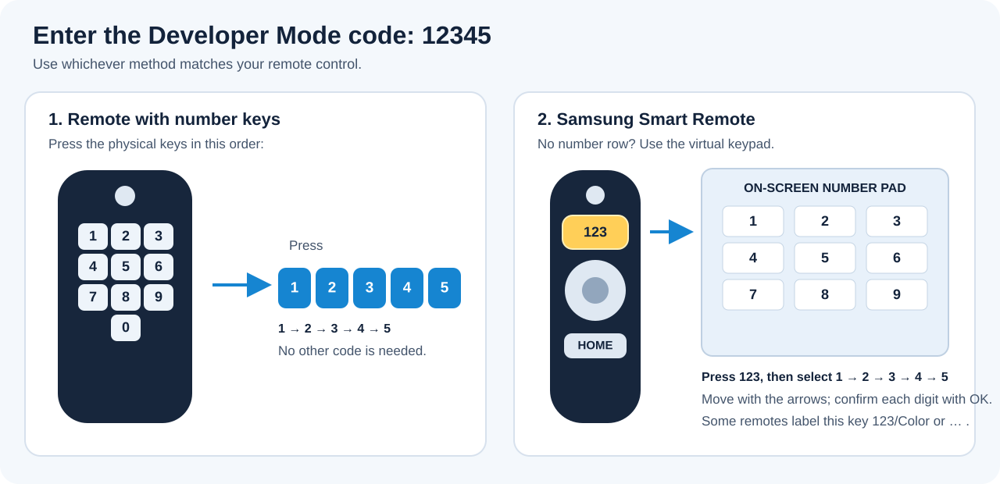

# Installationsanleitung

Die einfachste und empfehlenswerteste Möglichkeit ist, den Desktop-Installer zu verwenden, um Moonlight auf den Fernseher zu übertragen. Alternativ kannst du die Apps2Samsung-App oder, wenn du fortgeschrittene Kenntnisse hast, die Entwicklungsplattform Tizen Studio verwenden. Die App wird außerdem als unsignierte WGT-Pakete bereitgestellt, kann in diesem Format jedoch nicht direkt auf dem Fernseher installiert werden.

## Methode A: Moonlight-Desktop-Installer verwenden

Empfohlen wird der **Moonlight Tizen Installer**. Führe ihn auf einem Windows-, Linux- oder macOS-Computer im selben lokalen Netzwerk wie der Fernseher aus. Er erkennt kompatible Samsung-Fernseher, führt durch die Installation und bereitet das Paket automatisch vor.

### 1. Passenden Installer herunterladen

Öffne die [aktuelle stabile Version](https://github.com/fidoboy/moonlight-tizen-ac3/releases/latest) und lade unter **Assets** die passende Datei herunter:

- **Windows 64-Bit:** `MoonlightTizenInstaller.exe`
- **Linux 64-Bit:** `MoonlightTizenInstaller.tar.gz`
- **macOS Intel:** `MoonlightTizenInstaller-osx-x64.zip`
- **macOS Apple Silicon:** `MoonlightTizenInstaller-osx-arm64.zip`

Der Installer ist eine eigenständige ausführbare Datei, die bereits alles Notwendige enthält, einschließlich der TizenOS-App selbst, die auf deinen Fernseher übertragen wird.

### 2. Installer starten

- **Windows:** Doppelklicke auf die `.exe`. Falls Microsoft Defender SmartScreen warnt, prüfe vor dem Start, ob die Datei aus dem offiziellen Release dieses Projekts stammt.
- **macOS:** Öffne in Finder **Downloads**, klicke mit gedrückter Ctrl-Taste (oder rechts) auf die Datei und wähle **Öffnen**. Bestätige die Rückfrage. Wurde die App blockiert, gehe zu **Systemeinstellungen → Datenschutz & Sicherheit**, suche den Hinweis und wähle **Dennoch öffnen**. Verwende Intel auf Intel-Macs und ARM64 auf Apple-Silicon-Macs.
- **Linux:** Öffne ein Terminal im Download-Ordner und führe aus:
  ```bash
  tar -xzf MoonlightTizenInstaller.tar.gz
  cd MoonlightTizenInstaller
  chmod +x install.sh
  ./install.sh
  ```
  Alternativ kannst du im Dateimanager **Datei als Programm ausführen erlauben** aktivieren, sofern verfügbar, und die Datei öffnen.

### 3. Dem Assistenten folgen

1. Schalte den Fernseher ein und verbinde Fernseher und Computer mit demselben **lokalen Netzwerk**. WLAN und Ethernet werden unterstützt, sofern die Geräte kommunizieren können.
2. Wähle im Begrüßungsbildschirm das Paket:
   - **Normal package** (Standard): für die meisten Fernseher empfohlen.
   - **Forced game mode package:** nur verwenden, wenn dein TV-Modell diese Variante zum Aktivieren des Spielemodus benötigt.
3. Starte die Gerätesuche, wähle den Fernseher aus und folge den Anweisungen.
4. Wenn **TV-Store** verfügbar ist, überträgt der Installer das Paket auf den Fernseher. Bestätige die Installation dort auf dem Fernseher.
5. Ist TV-Store nicht verfügbar oder schlägt die Übergabe fehl, führt der Assistent durch die direkte Installation. Dafür müssen **Developer Mode** aktiviert und **Host PC IP** wie angezeigt eingestellt sein. Der Installer ruft die Gerätekennung automatisch ab und richtet das Signaturprofil ein; die DUID muss nicht selbst gesucht oder eingegeben werden.
6. Warte auf die Abschlussmeldung und starte Moonlight über **Apps** am Fernseher.

> [!IMPORTANT]
> Lass den Installer geöffnet und befolge die Anweisungen. Die Übertragung an TV-Store schließt die Installation nicht ab: Du musst sie am Fernseher bestätigen. Bei direkter SDB-Installation müssen zuerst die angezeigten Developer-Mode-Schritte abgeschlossen werden.

> [!TIP]
> Apps2Samsung und Tizen Studio sind nicht erforderlich. Der Installer wählt den verfügbaren Weg und übernimmt die Signierung, falls die direkte SDB-Installation nötig ist.

### Fehlerbehebung

- **Fernseher wird nicht gefunden:** Prüfe, ob er eingeschaltet und im selben lokalen Netzwerk ist. Gast-WLAN, Client-Isolation oder getrennte VLANs können die Suche verhindern. Erlaube den Netzwerkzugriff in der Firewall, falls angefragt.
- **macOS blockiert die App:** Verwende Finder → Ctrl-Klick → **Öffnen** oder **Systemeinstellungen → Datenschutz & Sicherheit → Dennoch öffnen**.
- **Linux meldet fehlende Berechtigungen:** Führe den obigen Befehl `chmod +x` aus und starte die Datei erneut.
- **Developer Mode wird verlangt:** Folge den Anweisungen einschließlich Host PC IP und versuche es erneut.
- **TV-Store erhält das Paket, beendet die Installation aber nicht:** Bestätige die Installation am Fernseher. Falls TV-Store nicht fortfahren kann, nutze die SDB-Option des Assistenten.

## Methode B: Installation mit Apps2Samsung

### Vor dem Start

- Lade die für deinen Computer passende Version von [Apps2Samsung](https://apps2samsung.com/#download) herunter und starte sie.
- Verbinde Fernseher und Computer mit demselben **lokalen Netzwerk**. WLAN oder Ethernet ist möglich, sofern die Geräte miteinander kommunizieren können.

### 1. Lokale IP-Adresse des Computers ermitteln

Der Fernseher benötigt die IP-Adresse des Computers, auf dem Apps2Samsung läuft. Unter Windows:

1. Drücke **Win + R**, gib `cmd` ein und bestätige mit Enter.
2. Führe in der Eingabeaufforderung folgenden Befehl aus:

       ipconfig

3. Notiere beim tatsächlich verwendeten Netzwerkadapter (WLAN oder Ethernet) die **IPv4-Adresse**, beispielsweise `192.168.1.37`.

Verwende die IPv4-Adresse des Computers, **nicht** das Standardgateway, die TV-IP-Adresse, `127.0.0.1` oder deine öffentliche Internetadresse. Unter macOS findest du die Adresse des aktiven Adapters in **Systemeinstellungen → Netzwerk**; unter Linux führe `ip addr` aus und suche die `inet`-Adresse der aktiven Netzwerkschnittstelle. Halte die Adresse für den nächsten Schritt bereit.

### 2. Versteckte Entwicklermodus-Einstellungen am Fernseher öffnen

1. Schalte den Fernseher ein und drücke auf der Fernbedienung **Home** (oder **Smart Hub**).
2. Öffne **Apps**.
3. Bei neueren TV-Oberflächen navigiere zu **App Settings** (meist ein Zahnradsymbol unten auf dem Apps-Bildschirm) und öffne es. Bei manchen älteren Modellen kann der Code direkt im Apps-Bildschirm eingegeben werden.
4. Gib bei geöffnetem Apps/App-Settings-Bildschirm exakt diese Folge ein:

   **1 → 2 → 3 → 4 → 5**

   **Ziffern eingeben**

   - **Fernbedienung mit physischem Ziffernfeld:** Drücke nacheinander die fünf Zifferntasten 1, 2, 3, 4 und 5.
   - **Samsung Smart Remote ohne Zifferntasten:** Drücke die Taste **123** (bei manchen Fernbedienungen **123/Color** oder mit einem **…**-Symbol), um das Bildschirm-Ziffernfeld zu öffnen. Markiere mit dem Navigationsring jede Ziffer und drücke die mittlere Taste **OK/Select**. Wiederhole dies, bis 12345 eingegeben ist.

   Die folgende Grafik zeigt beide Eingabemethoden. Bei einer Fernbedienung mit Bildschirmtastatur sind fünf physische Zifferntasten nicht nötig.

   

5. Ein Dialog **Developer Mode** sollte erscheinen. Stelle **Developer Mode** auf **On**.
6. Gib unter **Host PC IP** (oder einem ähnlich benannten Feld) die IPv4-Adresse des Computers aus Schritt 1 ein.
7. Wähle **OK** und bestätige den Neustart des Fernsehers.

> [!IMPORTANT]
> Dieses Verfahren gilt für **Samsung Smart TVs mit Tizen**. Andere Hersteller verwenden ebenfalls Tizen-basierte TV-Plattformen, doch Menüs und Unterstützung für die Installation im Entwicklermodus können abweichen.

> [!TIP]
> Öffne nach dem Neustart erneut **Apps**. Bei vielen Samsung-Fernsehern erscheint oben ein **Develop Mode**-Hinweis. Er bestätigt, dass der Entwicklermodus aktiv ist. Modellspezifische Screenshots findest du in Samsungs offizieller [TV-Device-Anleitung](https://developer.samsung.com/smarttv/develop/getting-started/using-sdk/tv-device.html); auch die [Apps2Samsung-FAQ](https://github.com/Apps2Samsung/Apps2Samsung/wiki/FAQ#-how-to-enable-developer-mode-on-your-tv) erklärt die Codeeingabe mit einer Smart Remote.

### 3. Moonlight aus dem Apps2Samsung-Katalog installieren

1. Öffne Apps2Samsung am Computer.
2. Wähle den Fernseher aus, sobald er in den Suchergebnissen erscheint. Wird er nicht automatisch erkannt, gib seine IP-Adresse manuell ein, sofern diese Option vorhanden ist.
3. Öffne den App-Katalog und suche nach **Moonlight**.
4. Wähle **Moonlight** und anschließend die Variante **fidoboy · Enhanced · Dolby**.
5. Starte die Installation mit **Download & Install** und warte auf die Erfolgsmeldung von Apps2Samsung. Apps2Samsung lädt das Paket selbst herunter und bereitet es vor.
6. Öffne am Fernseher den Bildschirm **Apps** und starte Moonlight.

**Dies ist die empfohlene Methode.** Du musst weder GitHub Releases besuchen noch `Moonlight.wgt` manuell herunterladen. Beim ersten Start kann Apps2Samsung dich auffordern, dich mit deinem Samsung-Konto anzumelden, damit ein Signaturzertifikat erstellt werden kann. Folge den Anweisungen und belasse die Zertifikatsauswahl auf automatisch/Standard, sofern das Tool keinen anderen Zertifikatstyp verlangt. Eine manuelle Zertifikatskonfiguration in Seller Office ist nicht nötig.

> [!WARNING]
> **Installiere ein WGT nur manuell, wenn die Katalogmethode fehlschlägt.** Lade `Moonlight.wgt` aus dem [neuesten stabilen Release](https://github.com/fidoboy/moonlight-tizen-ac3/releases/latest) herunter. Wähle in Apps2Samsung **Custom WGT / TPK**, wähle die Datei aus und starte die Installation. Nutze diesen Umweg nur bei Bedarf.

### Fehlerbehebung

- **Der Developer-Mode-Dialog erscheint nicht:** Stelle sicher, dass der Apps-Bildschirm oder bei deinem Modell App Settings geöffnet ist. Gib `12345` dort ein, nicht im normalen TV-Einstellungsmenü. Öffne bei einer Smart Remote zuvor mit **123** (oder der entsprechenden virtuellen Taste) das Bildschirm-Ziffernfeld.
- **Apps2Samsung findet den Fernseher nicht oder kann keine Verbindung herstellen:** Prüfe, ob Developer Mode aktiv ist, beide Geräte im selben lokalen Netzwerk sind und Host PC IP am Fernseher exakt der aktuellen IPv4-Adresse des Computers entspricht. Gäste-WLAN oder Client-Isolierung im Router können die Kommunikation verhindern.
- **Auch nach dem Neustart keine Verbindung:** Trenne den Fernseher vollständig vom Strom, warte 10–15 Sekunden, schließe ihn wieder an und versuche es erneut. Das kann helfen, wenn die Entwicklerverbindung bei bestimmten Modellen nicht korrekt geöffnet wurde.
- **Installation schlägt wegen Signatur-/Zertifikatskonflikt fehl:** Folge der Meldung von Apps2Samsung. Wenn du von der Brightcraft-Basis-App wechselst, lies vor einer Deinstallation den Abschnitt [Von der Brightcraft-Basis-App wechseln](#von-der-brightcraft-basis-app-wechseln).

## Methode C: Tizen Studio

Tizen Studio ist die offizielle Samsung/Tizen-Entwicklungsumgebung und eignet sich für Entwickler und tiefergehende Fehlersuche.

1. Installiere Tizen Studio und die TV-Werkzeuge für die Zielversion von Tizen.
2. Aktiviere Developer Mode am Fernseher und notiere seine IP-Adresse.
3. Verbinde dich im Device Manager mit dem Fernseher.
4. Richte ein vom Fernseher akzeptiertes Zertifikatsprofil ein und signiere das WGT wie von Tizen Studio verlangt.
5. Installiere das Paket mit den Tizen-Paketierungs-/Deployment-Tools oder der IDE.

Verwende Samsungs aktuelle Dokumentation zur Installation von Tizen Studio und zur Einrichtung von TV-Zertifikaten, da sich die Abläufe je nach SDK und Betriebssystem unterscheiden.

## Paket selbst bauen

Der [Entwicklungsleitfaden](Development-Guide-de.html) erklärt den WGT-Build mit der mitgelieferten Dockerfile. Docker-Builds sind nützlich, um eine genaue Quellrevision oder beide Paketvarianten zu testen.

## Von der Brightcraft-Basis-App wechseln

Die unabhängige Release-Reihe beginnt bei Version 1.0.0, während die Basis-App eine höhere Version 1.18.x verwendete. Tizen kann daher ein direktes Downgrade ablehnen oder die Paketsignatur anders behandeln. Schlägt die Installation fehl, deinstalliere die vorherige App vor der Installation dieses Projekts. Dabei können lokale App-Daten gelöscht werden; notiere daher vorher Einstellungen und Host-Informationen. Weitere Informationen findest du in der [Anleitung zur Aktualisierung](Updating-Guide-de.html).

## Erster Start

Starte Moonlight über den Apps-Bildschirm, erlaube die Erkennung im lokalen Netzwerk und kopple den Client mit dem Host-PC. Wird er nicht automatisch angezeigt, nutze Add Host und gib IP-Adresse oder DNS-Namen des Hosts ein. Siehe den [Schnellstartleitfaden](Quick-Start-Guide-de.html).
