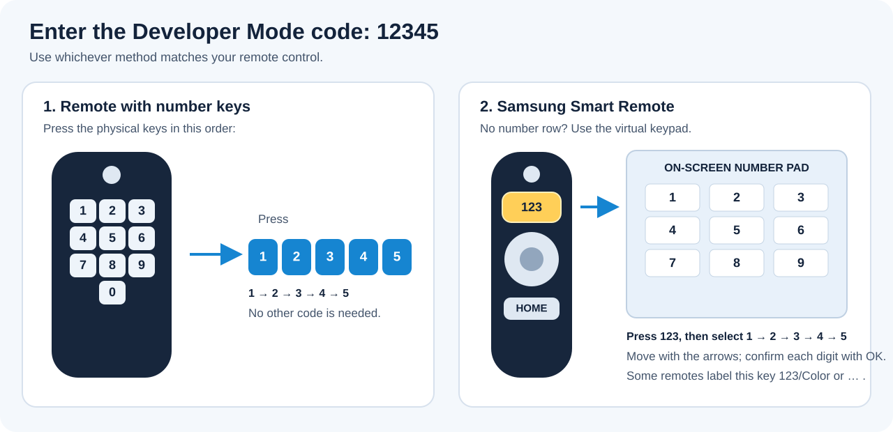

# Guía de instalación

La opción más sencilla y recomendable es utilizar el instalador de escritorio para transferir Moonlight al televisor. También puedes utilizar la aplicación Apps2Samsung o, si eres un usuario avanzado, la plataforma de desarrollo Tizen Studio. La aplicación también se distribuye en paquetes WGT sin firmar, pero este formato no permite instalarla directamente en el televisor.

## Método A: usar el instalador de Moonlight para ordenador

La opción recomendada es el **Moonlight Tizen Installer**. Ejecútalo en un ordenador Windows, Linux o macOS conectado a la misma red local que el televisor. Detecta televisores Samsung compatibles, te guía durante la instalación y prepara automáticamente el paquete.

### 1. Descarga el instalador adecuado

Abre la [última versión estable](https://github.com/fidoboy/moonlight-tizen-ac3/releases/latest) y descarga desde **Assets** el archivo correspondiente:

- **Windows de 64 bits:** `MoonlightTizenInstaller.exe`
- **Linux de 64 bits:** `MoonlightTizenInstaller.AppImage`
- **macOS Intel:** `MoonlightTizenInstaller-osx-x64.zip`
- **macOS Apple Silicon:** `MoonlightTizenInstaller-osx-arm64.zip`

El instalador es un archivo ejecutable independiente que ya incluye todo lo necesario, incluida la propia aplicación TizenOS, que se transfiere al televisor.

### 2. Ejecuta el instalador

- **Windows:** haz doble clic en el archivo `.exe`. Si Microsoft Defender SmartScreen muestra una advertencia, comprueba que lo has descargado de la publicación oficial de este proyecto antes de elegir ejecutarlo.
- **macOS:** en Finder, abre **Descargas**, haz clic derecho (o Control + clic) sobre el archivo y selecciona **Abrir**. Confirma si se solicita. Si macOS ya lo ha bloqueado, ve a **Ajustes del Sistema → Privacidad y seguridad** y pulsa **Abrir de todos modos**. Usa la versión Intel en Mac Intel y ARM64 en Mac Apple Silicon.
- **Linux:** abre un terminal en la carpeta de descargas y ejecuta:
  ```bash
chmod +x MoonlightTizenInstaller.AppImage
./MoonlightTizenInstaller.AppImage
```
  También puedes activar **Permitir ejecutar el archivo como un programa** en el gestor de archivos, si está disponible, y abrirlo.

### 3. Sigue el asistente

1. Enciende el televisor y conecta ambos dispositivos a la **misma red local**. Se admiten Wi-Fi y Ethernet si pueden comunicarse entre sí.
2. En la bienvenida, selecciona el paquete:
   - **Normal package** (predeterminado): recomendado para la mayoría de los televisores.
   - **Forced game mode package:** úsalo solo si tu modelo necesita esta variante para habilitar el modo Juego.
3. Inicia el análisis, selecciona el televisor cuando aparezca y sigue las instrucciones.
4. Si está disponible **TV-Store**, el instalador transferirá el paquete al televisor. Acepta allí la instalación para completar el proceso.
5. Si TV-Store no está disponible o falla la transferencia, el asistente te guiará por la instalación directa. Esta vía requiere **Developer Mode** y configurar **Host PC IP** como indique el asistente. El instalador obtiene automáticamente el identificador del televisor y prepara el perfil de firma; no tienes que buscar ni introducir el DUID.
6. Espera el mensaje de finalización e inicia Moonlight desde **Apps** en el televisor.

> [!IMPORTANT]
> Mantén abierto el instalador y sigue sus instrucciones. Transferir el paquete a TV-Store no completa la instalación: debes aceptarla en el televisor. Si se utiliza la instalación directa mediante SDB, completa primero los pasos de Developer Mode indicados.

> [!TIP]
> No necesitas Apps2Samsung ni Tizen Studio. El instalador selecciona la vía disponible y gestiona la firma cuando se requiere la instalación directa mediante SDB.

### Solución de problemas

- **No se encuentra el televisor:** comprueba que está encendido y conectado a la misma red local. El Wi-Fi de invitados, el aislamiento de clientes o las VLAN separadas pueden impedir la detección. Permite el acceso en el cortafuegos si se solicita.
- **Si macOS bloquea la app:** ve a **Ajustes del Sistema → Privacidad y seguridad → Abrir de todos modos**.
- **Linux indica que faltan permisos:** ejecuta el comando `chmod +x` anterior y vuelve a abrir el archivo.
- **Se solicita Developer Mode:** sigue las instrucciones del asistente, incluido el valor de Host PC IP, y vuelve a intentarlo.
- **TV-Store recibe el paquete pero no termina:** acepta la instalación en el televisor. Si TV-Store no puede continuar, utiliza la opción del asistente para seguir mediante SDB.

## Método B: instalar con Apps2Samsung

### Antes de empezar

- Descarga y ejecuta la versión de [Apps2Samsung](https://apps2samsung.com/#download) para tu ordenador.
- Conecta el televisor y el ordenador a la **misma red local**. Pueden usar Wi-Fi o Ethernet, siempre que puedan comunicarse entre sí.

### 1. Averigua la dirección IP local del ordenador

El televisor necesita la dirección IP del ordenador que ejecutará Apps2Samsung. En Windows:

1. Pulsa **Win + R**, escribe `cmd` y pulsa Intro.
2. En el símbolo del sistema, ejecuta:

       ipconfig

3. En el adaptador de red que estés utilizando (Wi-Fi o Ethernet), anota **Dirección IPv4**, por ejemplo `192.168.1.37`.

Utiliza la dirección IPv4 del ordenador, **no** la puerta de enlace predeterminada, la dirección IP del televisor, `127.0.0.1` ni la dirección pública de Internet. En macOS, consulta la dirección del adaptador activo en **Ajustes del Sistema → Red**; en Linux, ejecuta `ip addr` y busca la dirección `inet` de la interfaz de red activa. Ten esta dirección a mano para el siguiente paso.

### 2. Abre en el televisor los ajustes ocultos del modo de desarrollador

1. Enciende el televisor y pulsa **Home** (o **Smart Hub**) en el mando.
2. Abre **Apps**.
3. En interfaces de TV recientes, ve a **App Settings** (normalmente un icono de engranaje en la parte inferior de la pantalla Apps) y ábrelo. En algunos modelos antiguos, puedes introducir el código con la pantalla Apps abierta.
4. Con Apps/App Settings en pantalla, introduce esta secuencia exacta:

   **1 → 2 → 3 → 4 → 5**

   **Cómo introducir los números**

   - **Mando con teclado numérico físico:** pulsa las cinco teclas numéricas 1, 2, 3, 4 y 5 en ese orden.
   - **Samsung Smart Remote sin teclas numéricas:** pulsa el botón marcado **123** (en algunos mandos aparece como **123/Color** o con un símbolo **…**) para mostrar el teclado numérico en pantalla. Usa el aro direccional para resaltar cada dígito y pulsa el botón central **OK/Select** para introducirlo. Repite hasta introducir 12345.

   El diagrama siguiente muestra los dos métodos. No necesitas cinco teclas numéricas físicas si tu mando utiliza el teclado en pantalla.

   

5. Debería aparecer un diálogo **Developer Mode**. Cambia **Developer Mode** a **On**.
6. En **Host PC IP** (o un campo con nombre parecido), introduce la dirección IPv4 del ordenador del paso 1.
7. Selecciona **OK** y acepta el reinicio del televisor.

> [!IMPORTANT]
> Este procedimiento es para **televisores Samsung Smart TV con Tizen**. Otros fabricantes también utilizan plataformas de TV basadas en Tizen, pero sus menús y la compatibilidad con la instalación en modo desarrollador pueden variar.

> [!TIP]
> Tras reiniciar, vuelve a **Apps**. En muchos televisores Samsung aparece un indicador **Develop Mode** cerca de la parte superior de la pantalla. Confirma que el modo de desarrollador está activado. Para ver capturas específicas del modelo, consulta la [guía oficial de dispositivos de TV de Samsung](https://developer.samsung.com/smarttv/develop/getting-started/using-sdk/tv-device.html); las [preguntas frecuentes de Apps2Samsung](https://github.com/Apps2Samsung/Apps2Samsung/wiki/FAQ#-how-to-enable-developer-mode-on-your-tv) también explican cómo introducir el código con un Smart Remote.

### 3. Instala Moonlight desde el catálogo de Apps2Samsung

1. Abre Apps2Samsung en el ordenador.
2. Selecciona el televisor cuando aparezca en los resultados de búsqueda. Si no se detecta automáticamente, introduce manualmente su dirección IP si está disponible esa opción.
3. Abre el catálogo de aplicaciones y busca **Moonlight**.
4. Selecciona **Moonlight** y elige la variante **fidoboy · Enhanced · Dolby**.
5. Inicia la instalación con **Download & Install** y espera a que Apps2Samsung confirme que ha terminado correctamente. Apps2Samsung descarga y prepara el paquete por sí mismo.
6. Abre la pantalla **Apps** del televisor e inicia Moonlight.

**Este es el método recomendado.** No necesitas visitar GitHub Releases ni descargar manualmente `Moonlight.wgt`. La primera vez, Apps2Samsung puede pedirte que inicies sesión en tu cuenta Samsung para crear un certificado de firma. Sigue las indicaciones y deja la selección de certificado en la opción automática/predeterminada, salvo que la herramienta indique que hace falta otro tipo. No necesitas configurar certificados manualmente en Seller Office.

> [!WARNING]
> **Instala el WGT manualmente solo si falla el método del catálogo.** Descarga `Moonlight.wgt` desde la [última versión estable](https://github.com/fidoboy/moonlight-tizen-ac3/releases/latest). En Apps2Samsung, elige **Custom WGT / TPK**, selecciona el archivo descargado e inicia la instalación. No recurras a esta alternativa salvo que sea necesario.

### Solución de problemas

- **No aparece el diálogo Developer Mode:** asegúrate de estar en la pantalla Apps o en App Settings si tu modelo dispone de ese panel. Introduce `12345` ahí, no en el menú normal de ajustes del televisor. En un Smart Remote, abre primero el teclado numérico en pantalla con el botón **123** (o la tecla virtual equivalente).
- **Apps2Samsung no encuentra el televisor o no puede conectarse:** confirma que Developer Mode sigue activado, que ambos dispositivos están en la misma red local y que Host PC IP en el televisor coincide exactamente con la dirección IPv4 actual del ordenador. Las redes Wi-Fi de invitados o el aislamiento de clientes del router pueden impedir la comunicación.
- **Sigue sin conectarse tras reiniciar:** desenchufa completamente el televisor, espera entre 10 y 15 segundos, vuelve a conectarlo e inténtalo de nuevo. Puede ayudar en modelos en los que la conexión de desarrollo no se haya abierto correctamente.
- **La instalación falla por incompatibilidad de firma/certificado:** sigue el mensaje de Apps2Samsung. Si estás pasando de la aplicación base de Brightcraft, consulta abajo [Cambiar desde la aplicación base de Brightcraft](#cambiar-desde-la-aplicación-base-de-brightcraft) antes de desinstalar nada.

## Método C: Tizen Studio

Tizen Studio es el entorno oficial de desarrollo de Samsung/Tizen y resulta útil para desarrolladores y para diagnósticos más avanzados.

1. Instala Tizen Studio y las herramientas de TV adecuadas para la versión de Tizen de destino.
2. Activa Developer Mode en el televisor y anota su dirección IP.
3. En Device Manager, conecta con el televisor.
4. Configura un perfil de certificado aceptado por el televisor y firma el WGT según requiera Tizen Studio.
5. Instala el paquete con las herramientas de empaquetado/despliegue de Tizen o desde el IDE.

Consulta la documentación actual de Samsung para instalar Tizen Studio y configurar certificados de TV, ya que el procedimiento varía según el SDK y el sistema operativo.

## Compilar el paquete

La [Guía de desarrollo](Development-Guide-es.html) explica cómo compilar el WGT mediante el Dockerfile incluido. Las compilaciones con Docker son útiles para probar una revisión exacta del código fuente o las dos variantes del paquete.

## Cambiar desde la aplicación base de Brightcraft

La serie de versiones independiente comienza en 1.0.0, mientras que la aplicación base utilizaba una versión superior, 1.18.x. Por ello, Tizen puede rechazar una bajada de versión en el sitio o tratar de forma distinta la firma del paquete. Si falla la instalación, desinstala la aplicación anterior antes de instalar este proyecto. La desinstalación puede borrar los datos locales de la aplicación, así que anota primero tus ajustes y los datos de los hosts. Consulta la [guía de actualización](Updating-Guide-es.html) para más detalles.

## Primer inicio

Inicia Moonlight desde la pantalla Apps del televisor, permite el descubrimiento en la red local y empareja con el PC host. Si no aparece automáticamente, usa Add Host e introduce la dirección IP o el nombre DNS del host. Consulta la [Guía de inicio rápido](Quick-Start-Guide-es.html).
