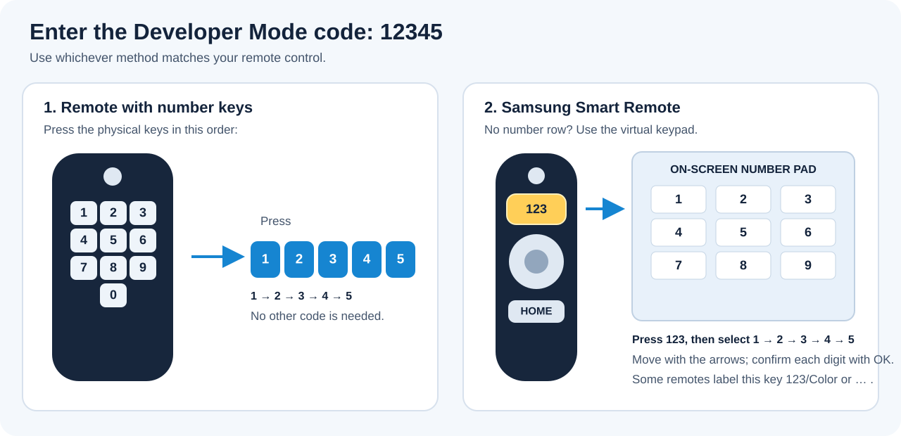

# Guida all'installazione

L’opzione più semplice e consigliata è utilizzare l’installer desktop per trasferire Moonlight sul televisore. È anche possibile utilizzare l’app Apps2Samsung oppure, per gli utenti più esperti, la piattaforma di sviluppo Tizen Studio. L’app è distribuita anche sotto forma di pacchetti WGT non firmati, ma in questo formato non può essere installata direttamente sul televisore.

## Metodo A: usare l’installer desktop di Moonlight

L’opzione consigliata è il **Moonlight Tizen Installer**. Eseguilo su un computer Windows, Linux o macOS collegato alla stessa rete locale del televisore. Rileva i televisori Samsung compatibili, ti guida e prepara automaticamente il pacchetto.

### 1. Scarica l’installer corretto

Apri l’[ultima versione stabile](https://github.com/fidoboy/moonlight-tizen-ac3/releases/latest) e scarica da **Assets** il file adatto:

- **Windows a 64 bit:** `MoonlightTizenInstaller-win-x64.exe`
- **Linux a 64 bit:** `MoonlightTizenInstaller-linux-x64`
- **macOS Intel:** `MoonlightTizenInstaller-osx-x64`
- **macOS Apple Silicon:** `MoonlightTizenInstaller-osx-arm64`

L’installer è un file eseguibile autonomo che include già tutto il necessario, compresa l’app TizenOS stessa, che viene trasferita sul televisore.

### 2. Avvia l’installer

- **Windows:** fai doppio clic sul file `.exe`. Se Microsoft Defender SmartScreen mostra un avviso, verifica che il file provenga dalla release ufficiale del progetto prima di scegliere di eseguirlo.
- **macOS:** in Finder apri **Download**, fai clic destro (o Ctrl-clic) sul file e scegli **Apri**. Conferma se richiesto. Se macOS lo ha bloccato, vai in **Impostazioni di Sistema → Privacy e sicurezza**, individua l’avviso e scegli **Apri comunque**. Usa Intel sui Mac Intel e ARM64 sui Mac Apple Silicon.
- **Linux:** apri un terminale nella cartella dei download ed esegui:
  ```bash
  chmod +x MoonlightTizenInstaller-linux-x64
  ./MoonlightTizenInstaller-linux-x64
  ```
  In alternativa, attiva **Consenti l’esecuzione del file come programma** nel gestore file, se disponibile, e apri il file.

### 3. Segui la procedura guidata

1. Accendi il televisore e collega TV e computer alla **stessa rete locale**. Wi-Fi ed Ethernet sono supportati se i dispositivi possono comunicare.
2. Nella schermata iniziale scegli il pacchetto:
   - **Normal package** (predefinito): consigliato per la maggior parte dei televisori.
   - **Forced game mode package:** usalo solo se il tuo modello richiede questa variante per abilitare la Modalità Gioco.
3. Avvia la scansione, seleziona il televisore quando compare e segui le istruzioni.
4. Se è disponibile **TV-Store**, l’installer trasferisce il pacchetto alla TV. Accetta l’installazione in TV-Store direttamente sul televisore.
5. Se TV-Store non è disponibile o il trasferimento non riesce, la procedura guidata ti accompagna nell’installazione diretta. Questa richiede **Developer Mode** e la configurazione di **Host PC IP** come indicato. L’installer recupera automaticamente l’identificativo del televisore e prepara il profilo di firma: non devi cercare o inserire il DUID.
6. Attendi il messaggio di completamento e avvia Moonlight da **Apps** sul televisore.

> [!IMPORTANT]
> Lascia aperto l’installer e segui le istruzioni. Il trasferimento a TV-Store non completa l’installazione: devi accettarla sul televisore. Per l’installazione diretta tramite SDB, completa prima i passaggi Developer Mode indicati.

> [!TIP]
> Non servono Apps2Samsung o Tizen Studio. L’installer sceglie il metodo disponibile e gestisce la firma quando è necessaria l’installazione diretta tramite SDB.

### Risoluzione dei problemi

- **TV non rilevata:** verifica che sia accesa e sulla stessa rete locale. Wi-Fi ospite, isolamento dei client o VLAN separate possono impedire il rilevamento. Se richiesto, consenti l’accesso tramite il firewall.
- **macOS blocca l’app:** usa Finder → Ctrl-clic → **Apri**, oppure **Impostazioni di Sistema → Privacy e sicurezza → Apri comunque**.
- **Linux segnala permessi insufficienti:** esegui il comando `chmod +x` sopra e riavvia il file.
- **Viene richiesto Developer Mode:** segui le istruzioni, incluso il valore Host PC IP, e riprova.
- **TV-Store riceve il pacchetto ma non termina:** accetta l’installazione sulla TV. Se TV-Store non può proseguire, usa l’opzione SDB proposta dall’assistente.

## Metodo B: installazione con Apps2Samsung

### Prima di iniziare

- Scarica ed esegui la versione di [Apps2Samsung](https://apps2samsung.com/#download) per il tuo computer.
- Collega televisore e computer alla **stessa rete locale**. Puoi usare Wi-Fi o Ethernet, purché i dispositivi possano comunicare.

### 1. Trova l'indirizzo IP locale del computer

Il televisore ha bisogno dell'indirizzo IP del computer che eseguirà Apps2Samsung. Su Windows:

1. Premi **Win + R**, digita `cmd` e premi Invio.
2. Nel Prompt dei comandi esegui:

       ipconfig

3. Sull'adattatore di rete effettivamente utilizzato (Wi-Fi o Ethernet), annota **Indirizzo IPv4**, per esempio `192.168.1.37`.

Usa l'indirizzo IPv4 del computer, **non** il gateway predefinito, l'indirizzo IP del televisore, `127.0.0.1` o l'indirizzo Internet pubblico. Su macOS, trova l'indirizzo dell'adattatore attivo in **Impostazioni di Sistema → Rete**; su Linux esegui `ip addr` e cerca l'indirizzo `inet` dell'interfaccia di rete attiva. Tieni l'indirizzo a portata di mano per il passaggio successivo.

### 2. Apri sul televisore le impostazioni nascoste della modalità sviluppatore

1. Accendi il televisore e premi **Home** (o **Smart Hub**) sul telecomando.
2. Apri **Apps**.
3. Nelle interfacce TV più recenti, vai in **App Settings** (di solito un'icona a ingranaggio nella parte bassa della schermata Apps) e aprila. Su alcuni modelli precedenti è possibile inserire il codice direttamente dalla schermata Apps.
4. Con Apps/App Settings sullo schermo, inserisci esattamente questa sequenza:

   **1 → 2 → 3 → 4 → 5**

   **Come inserire le cifre**

   - **Telecomando con tastierino numerico fisico:** premi in ordine i cinque tasti 1, 2, 3, 4 e 5.
   - **Samsung Smart Remote senza tasti numerici:** premi il pulsante **123** (su alcuni telecomandi è indicato come **123/Color** o con il simbolo **…**) per mostrare il tastierino a schermo. Usa l'anello direzionale per selezionare ogni cifra e premi il tasto centrale **OK/Select**. Ripeti fino a inserire 12345.

   Il diagramma seguente mostra entrambi i metodi. Se il telecomando usa il tastierino a schermo non servono cinque tasti numerici fisici.

   

5. Dovrebbe apparire una finestra **Developer Mode**. Imposta **Developer Mode** su **On**.
6. In **Host PC IP** (o un campo con nome simile), inserisci l'indirizzo IPv4 del computer annotato nel passaggio 1.
7. Seleziona **OK** e accetta il riavvio del televisore.

> [!IMPORTANT]
> Questa procedura è destinata ai **Samsung Smart TV con Tizen**. Anche altri produttori usano piattaforme TV basate su Tizen, ma menu e supporto per l'installazione in modalità sviluppatore possono variare.

> [!TIP]
> Dopo il riavvio, torna in **Apps**. Molti televisori Samsung mostrano un indicatore **Develop Mode** nella parte superiore della schermata, a conferma che la modalità sviluppatore è attiva. Per schermate specifiche del modello, consulta la [guida ufficiale Samsung TV Device](https://developer.samsung.com/smarttv/develop/getting-started/using-sdk/tv-device.html); anche le [FAQ di Apps2Samsung](https://github.com/Apps2Samsung/Apps2Samsung/wiki/FAQ#-how-to-enable-developer-mode-on-your-tv) spiegano come inserire il codice con una Smart Remote.

### 3. Installa Moonlight dal catalogo Apps2Samsung

1. Apri Apps2Samsung sul computer.
2. Seleziona il televisore quando appare nei risultati della scansione. Se non viene rilevato automaticamente, inserisci manualmente il suo indirizzo IP se l'opzione è disponibile.
3. Apri il catalogo delle applicazioni e cerca **Moonlight**.
4. Seleziona **Moonlight**, quindi scegli la variante **fidoboy · Enhanced · Dolby**.
5. Avvia l'installazione con **Download & Install** e attendi la conferma di successo di Apps2Samsung. Il programma scarica e prepara il pacchetto automaticamente.
6. Apri la schermata **Apps** del televisore e avvia Moonlight.

**Questo è il metodo consigliato.** Non serve visitare GitHub Releases o scaricare manualmente `Moonlight.wgt`. Al primo utilizzo, Apps2Samsung potrebbe chiederti di accedere all'account Samsung per creare un certificato di firma. Segui le istruzioni e lascia la selezione del certificato su automatica/predefinita, a meno che il programma richieda un altro tipo. Non occorre configurare manualmente i certificati in Seller Office.

> [!WARNING]
> **Installa un WGT manualmente solo se il metodo del catalogo non funziona.** Scarica `Moonlight.wgt` dall'[ultima release stabile](https://github.com/fidoboy/moonlight-tizen-ac3/releases/latest). In Apps2Samsung scegli **Custom WGT / TPK**, seleziona il file scaricato e avvia l'installazione. Usa questa alternativa solo se necessario.

### Risoluzione dei problemi

- **La finestra Developer Mode non appare:** assicurati di essere nella schermata Apps o, se disponibile sul tuo modello, in App Settings. Inserisci `12345` lì, non nel normale menu Impostazioni del televisore. Con una Smart Remote, apri prima il tastierino a schermo tramite **123** (o il pulsante virtuale equivalente).
- **Apps2Samsung non trova il televisore o non si connette:** verifica che Developer Mode sia ancora attivo, che entrambi i dispositivi siano sulla stessa rete locale e che Host PC IP sul televisore corrisponda esattamente all'IPv4 attuale del computer. Il Wi-Fi ospiti o l'isolamento client del router possono impedire la comunicazione.
- **La connessione non funziona nemmeno dopo il riavvio:** scollega completamente il televisore dall'alimentazione, attendi 10–15 secondi, ricollegalo e riprova. Può essere utile sui modelli in cui la connessione sviluppatore non si è aperta correttamente.
- **L'installazione fallisce per un conflitto di firma/certificato:** segui il messaggio di Apps2Samsung. Se stai passando dall'app base Brightcraft, consulta prima [Passare dall'app base Brightcraft](#passare-dallapp-base-brightcraft).

## Metodo C: Tizen Studio

Tizen Studio è l'ambiente ufficiale di sviluppo Samsung/Tizen, utile per sviluppatori e diagnosi più approfondite.

1. Installa Tizen Studio e gli strumenti TV adatti alla versione Tizen di destinazione.
2. Abilita Developer Mode sul televisore e annota il suo indirizzo IP.
3. In Device Manager, connettiti al televisore.
4. Configura un profilo certificato accettato dal televisore e firma il WGT secondo le richieste di Tizen Studio.
5. Installa il pacchetto con gli strumenti di packaging/deploy di Tizen o dall'IDE.

Consulta la documentazione Samsung aggiornata per installare Tizen Studio e configurare i certificati TV, poiché le procedure variano in base a SDK e sistema operativo.

## Compilare il pacchetto

La [Guida allo sviluppo](Development-Guide-it.html) spiega come compilare il WGT con il Dockerfile incluso. Le build Docker sono utili per testare una revisione esatta del codice sorgente o le due varianti del pacchetto.

## Passare dall'app base Brightcraft

La serie indipendente di release inizia dalla versione 1.0.0, mentre l'app base usava una versione superiore, 1.18.x. Tizen potrebbe quindi rifiutare un downgrade diretto o trattare diversamente la firma del pacchetto. Se l'installazione fallisce, disinstalla la vecchia applicazione prima di installare questo progetto. La disinstallazione può eliminare dati locali dell'app: annota prima le impostazioni e i dettagli degli host. Per maggiori dettagli, consulta la [guida all'aggiornamento](Updating-Guide-it.html).

## Primo avvio

Avvia Moonlight dalla schermata Apps del televisore, consenti il rilevamento sulla rete locale e abbinalo al PC host. Se non appare automaticamente, usa Add Host e inserisci l'indirizzo IP o il nome DNS dell'host. Consulta la [Guida rapida](Quick-Start-Guide-it.html).
