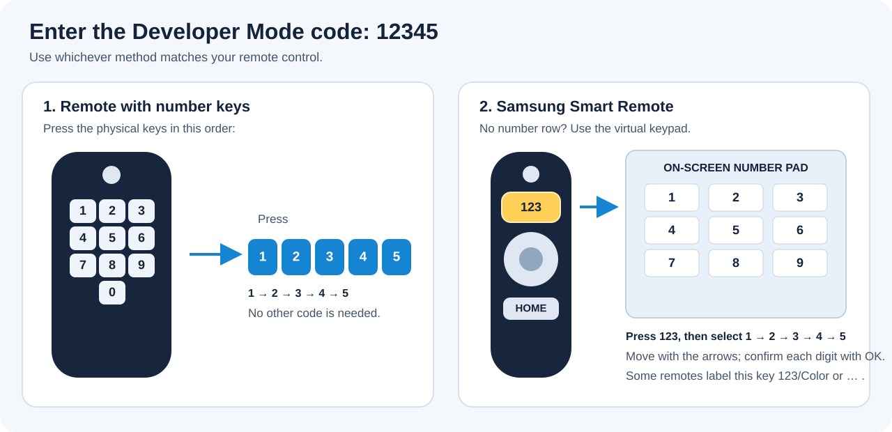

# Руководство по установке

Клиент распространяется как подписанный виджет Tizen (`.wgt`). Выберите способ установки с учётом телевизора, компьютера и установленных инструментов разработки Samsung.

## Способ A: установка через Apps2Samsung

### Перед началом

- Скачайте и запустите подходящую для компьютера версию [Apps2Samsung](https://apps2samsung.com/#download).
- Подключите телевизор и компьютер к **одной локальной сети**. Можно использовать Wi-Fi или Ethernet, если устройства могут обмениваться данными.

### 1. Узнайте локальный IP-адрес компьютера

Телевизору нужен IP-адрес компьютера, на котором будет работать Apps2Samsung. В Windows:

1. Нажмите **Win + R**, введите `cmd` и нажмите Enter.
2. В командной строке выполните:

       ipconfig

3. У используемого сетевого адаптера (Wi-Fi или Ethernet) найдите **IPv4-адрес**, например `192.168.1.37`.

Используйте IPv4-адрес компьютера, а **не** основной шлюз, IP-адрес телевизора, `127.0.0.1` или публичный интернет-адрес. В macOS адрес активного адаптера находится в **Системных настройках → Сеть**; в Linux выполните `ip addr` и найдите адрес `inet` активного сетевого интерфейса. Сохраните адрес для следующего шага.

### 2. Откройте скрытые настройки режима разработчика на телевизоре

1. Включите телевизор и нажмите **Home** (или **Smart Hub**) на пульте.
2. Откройте **Apps**.
3. В новых интерфейсах перейдите в **App Settings** (обычно значок шестерёнки в нижней части экрана Apps). На некоторых старых моделях код можно вводить прямо на экране Apps.
4. Когда открыт Apps/App Settings, введите строго эту последовательность:

   **1 → 2 → 3 → 4 → 5**

   **Как ввести цифры**

   - **Пульт с физической цифровой клавиатурой:** по очереди нажмите кнопки 1, 2, 3, 4 и 5.
   - **Samsung Smart Remote без цифровых кнопок:** нажмите кнопку **123** (на некоторых пультах — **123/Color** или символ **…**), чтобы открыть экранную цифровую клавиатуру. Выберите каждую цифру кольцом навигации и нажмите центральную кнопку **OK/Select**. Повторяйте, пока не будет введено 12345.

   На схеме ниже показаны оба способа. Если на пульте используется экранная клавиатура, пять физических цифровых кнопок не нужны.

   

5. Должно появиться окно **Developer Mode**. Установите **Developer Mode** в положение **On**.
6. В поле **Host PC IP** (или с похожим названием) укажите IPv4-адрес компьютера из шага 1.
7. Выберите **OK** и согласитесь перезапустить телевизор.

> [!IMPORTANT]
> Эта инструкция относится к **телевизорам Samsung Smart TV на Tizen**. Другие производители также используют телевизионные платформы на базе Tizen, но меню и установка в режиме разработчика могут отличаться.

> [!TIP]
> После перезапуска снова откройте **Apps**. На многих телевизорах Samsung вверху экрана появляется отметка **Develop Mode**, подтверждающая включение режима разработчика. Скриншоты для конкретных моделей есть в [официальном руководстве Samsung TV Device](https://developer.samsung.com/smarttv/develop/getting-started/using-sdk/tv-device.html); [FAQ Apps2Samsung](https://github.com/Apps2Samsung/Apps2Samsung/wiki/FAQ#-how-to-enable-developer-mode-on-your-tv) также объясняет ввод кода на Smart Remote.

### 3. Установите Moonlight из каталога Apps2Samsung

1. Откройте Apps2Samsung на компьютере.
2. Выберите телевизор после появления в результатах поиска. Если автоматическое обнаружение не сработало, введите IP-адрес вручную, если такая возможность доступна.
3. Откройте каталог приложений и найдите **Moonlight**.
4. Выберите **Moonlight**, затем вариант **fidoboy · Enhanced · Dolby** или, если этого требует модель телевизора, **fidoboy · Enhanced · Dolby · ForceGM**.
5. Нажмите **Download & Install** и дождитесь сообщения об успешной установке. Apps2Samsung самостоятельно скачает и подготовит пакет.
6. Откройте на телевизоре экран **Apps** и запустите Moonlight.

**Это рекомендуемый способ.** Не нужно заходить на GitHub Releases и вручную скачивать `Moonlight.wgt`. При первом использовании Apps2Samsung может попросить войти в учётную запись Samsung, чтобы создать сертификат подписи. Следуйте подсказкам и оставьте выбор сертификата автоматическим/по умолчанию, если программа не требует другого типа. Вручную настраивать сертификаты в Seller Office не нужно.

> [!WARNING]
> **Устанавливайте WGT вручную, только если установка из каталога не сработала.** Скачайте `Moonlight.wgt` из [последнего стабильного релиза](https://github.com/fidoboy/moonlight-tizen-ac3/releases/latest). В Apps2Samsung выберите **Custom WGT / TPK**, укажите скачанный файл и начните установку. Используйте этот обходной путь только при необходимости. Для ForceGM скачайте `Moonlight-ForceGM.wgt` с той же страницы релизов.

### Устранение неполадок

- **Окно Developer Mode не появляется:** убедитесь, что открыт экран Apps или App Settings, если он есть на вашей модели. Введите `12345` именно там, а не в обычном меню настроек телевизора. На Smart Remote сначала откройте экранную клавиатуру кнопкой **123** или аналогичной виртуальной кнопкой.
- **Apps2Samsung не находит телевизор или не подключается:** проверьте, что Developer Mode включён, оба устройства находятся в одной локальной сети, а Host PC IP на телевизоре точно совпадает с текущим IPv4 компьютера. Гостевой Wi-Fi или изоляция клиентов роутера могут блокировать связь.
- **После перезапуска подключения всё ещё нет:** полностью отключите телевизор от питания на 10–15 секунд, подключите снова и повторите попытку. Это может помочь моделям, на которых соединение разработчика не открылось корректно.
- **Установка не проходит из-за несовпадения подписи/сертификата:** следуйте сообщению Apps2Samsung. Если переходите с базового приложения Brightcraft, перед удалением прочитайте раздел [Переход с базового приложения Brightcraft](#переход-с-базового-приложения-brightcraft).

## Способ B: Tizen Studio

Tizen Studio — официальная среда разработки Samsung/Tizen, полезная разработчикам и для более сложной диагностики.

1. Установите Tizen Studio и инструменты TV для целевой версии Tizen.
2. Включите Developer Mode на телевизоре и запишите его IP-адрес.
3. В Device Manager подключитесь к телевизору.
4. Настройте профиль сертификата, принимаемый телевизором, и подпишите WGT согласно требованиям Tizen Studio.
5. Установите пакет через инструменты упаковки/развёртывания Tizen или IDE.

Используйте актуальную документацию Samsung по установке Tizen Studio и настройке сертификатов TV: процедуры различаются в зависимости от SDK и операционной системы.

## Сборка пакета

В [руководстве разработчика](Development-Guide-ru.html) описана сборка WGT с помощью включённого Dockerfile. Сборки Docker удобны для проверки конкретной ревизии исходников или двух вариантов пакета.

## Переход с базового приложения Brightcraft

Независимая линейка релизов начинается с версии 1.0.0, тогда как базовое приложение использовало более высокий номер 1.18.x. Поэтому Tizen может отклонить установку поверх существующего приложения как понижение версии или иначе обработать подпись пакета. Если установка не проходит, удалите прежнее приложение перед установкой этого проекта. При удалении могут пропасть локальные данные, поэтому сначала запишите настройки и данные хостов. Подробнее см. в [руководстве по обновлению](Updating-Guide-ru.html).

## Первый запуск

Запустите Moonlight с экрана Apps, разрешите обнаружение в локальной сети и выполните сопряжение с ПК-хостом. Если он не появился автоматически, выберите Add Host и введите IP-адрес или DNS-имя хоста. См. [Краткое руководство](Quick-Start-Guide-ru.html).
